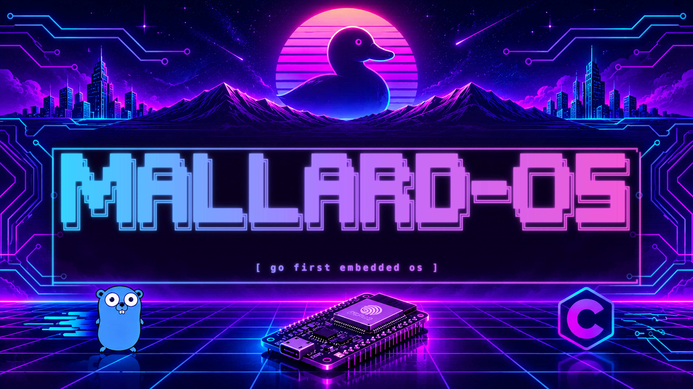

<p align="center">
  
</p>


# 🦆 Mallard-OS

### One OS. Multiple Platforms. Go-First by Design.

**Mallard-OS** is a portable, modular, Go-first embedded operating environment designed for microcontrollers and future hosted embedded-computing platforms.

Built primarily with Go and TinyGo, Mallard-OS aims to provide a consistent operating environment across different hardware architectures through hardware abstraction, capability-driven device management, modular subsystems, and platform-independent APIs.

The project currently targets the **ESP32-S3**, with ESP32-C3 compatibility as the next development objective.

> One OS. Multiple platforms. Modular by design. Go-first by default.

**Status:** Work in Progress  
**Current milestone:** v0.3 — Device Manager  
**Primary language:** Go  
**Initial runtime:** TinyGo 0.44.0

---

## ✨ Vision

Mallard-OS is an attempt to build an embedded operating environment using Go as its primary language.

Rather than building software around a particular development board, Mallard-OS is designed around hardware capabilities.

The objective is to allow applications and system services to interact with hardware through consistent Go APIs without depending directly on board-specific implementations.

### Core objectives

- **Portability:** Support multiple microcontroller architectures and eventually hosted platforms.
- **Modularity:** Keep system components independent and replaceable.
- **Hardware abstraction:** Provide consistent interfaces for different peripherals and devices.
- **Capability-driven design:** Allow hardware features to be optional rather than mandatory.
- **Go-first development:** Keep Go as the primary language for system and application development.
- **Resource awareness:** Account for limited CPU, memory, storage, and power.
- **Testability:** Develop and test hardware-independent components on a host machine.
- **Extensibility:** Allow new platforms and drivers without rewriting the OS core.

---

## 🖥️ Platform Support

Mallard-OS is designed to support multiple hardware platforms over time.

### Current development targets

| Platform | Architecture | Status |
|---|---|---|
| Seeed XIAO ESP32-S3 N16R8 | Xtensa LX7 | 🟢 Current target |
| ESP32-C3 | RISC-V | 🟡 Next target |
| ESP32 | Xtensa LX6 | 🔵 Planned |

### Future platforms

| Platform | Architecture | Priority |
|---|---|---|
| Raspberry Pi Pico | ARM Cortex-M0+ | Future |
| Raspberry Pi Pico 2 | ARM / RISC-V | Future |
| STM32 | ARM Cortex-M | Future |
| Raspberry Pi SBC | ARM Cortex-A | Long-term |
| Orange Pi SBC | ARM variants | Long-term |

### Execution profiles

Two execution profiles are envisioned:

**Embedded Profile**
- Runs directly on supported hardware.
- Uses an embedded Go runtime such as TinyGo.
- Provides hardware access through platform implementations.
- Optimized for constrained resources.

**Hosted Profile**
- Runs as a process on a supported host operating system, initially Linux.
- Intended for SBCs, development, testing, and potentially application-class hardware.
- Shares hardware-independent APIs and system logic where practical.

Hosted execution is a future architectural direction, not a current supported feature.

---

## 🏗️ Architecture

Mallard-OS follows a layered architecture that separates applications, operating-system functionality, hardware interfaces, drivers, and physical hardware.

```text
                 APPLICATIONS
                      |
                  SHELL / CLI
                      |
                 OS SUBSYSTEMS
                      |
          +-----------+-----------+
          |           |           |
        Storage    Services    Runtime
          |           |           |
          +-----------+-----------+
                      |
                DEVICE MANAGER
                      |
                     HAL
                      |
                   DRIVERS
                      |
                   PLATFORM
                      |
              PHYSICAL HARDWARE
```

### Architectural layers

| Layer | Responsibility |
|---|---|
| Applications | User-facing applications built for Mallard-OS |
| OS Subsystems | Storage, networking, logging, monitoring and services |
| Device Manager | Device registration, lifecycle and capability discovery |
| HAL | Hardware-independent interfaces |
| Drivers | Peripheral and device implementations |
| Platform | Board-specific initialization and hardware integration |
| Runtime | Go runtime and platform execution facilities |

### Core design principle

Hardware-dependent implementations should remain behind stable interfaces.

For example, an application requesting GPIO functionality should not need to know whether the underlying implementation uses an ESP32 GPIO peripheral, an STM32 GPIO controller, or another supported platform.

---

## 🧩 Technology Stack

| Technology | Responsibility | Status |
|---|---|---|
| Go | Primary development language | Active |
| TinyGo 0.44.0 | Embedded compiler and runtime | Working |
| ESP32-S3 | Initial hardware platform | Working |
| USB Serial/JTAG | Interactive terminal communication | Verified |
| TinyGo `machine` | Hardware peripheral access | Partially implemented |
| `cores` scheduler | Experimental multicore scheduling | Untested on hardware |
| espradio | Wi-Fi and Bluetooth | Planned |
| lneto | Networking stack | Planned |
| LittleFS | Persistent filesystem | Untested |
| C | Native platform integration | As needed |
| Python | Host-side tools and automation | Active |

Go remains the primary implementation language.

C is reserved for platform or runtime capabilities that cannot reasonably be provided through Go/TinyGo.

Python is intended for host-side tooling, testing, serial communication, and development automation.

---

## ⚙️ Current Implementation

Mallard-OS has progressed beyond the initial bootloader and terminal stage.

The current implementation includes an interactive shell, command system, hardware abstraction foundation, runtime utilities, and a kernel lifecycle manager.

### v0.1 — Boot and Console

**Status: Complete**

Implemented:

- System boot sequence.
- USB Serial/JTAG communication.
- Interactive terminal.
- Console abstraction.
- Terminal input and output.
- Character buffering.
- Echo handling.
- Backspace handling.
- Enter key handling.

### v0.2 — Interactive Shell

**Status: Complete**

Implemented:

- Shell execution loop.
- Command parser.
- Command registry.
- Command dispatch.
- Command handler interface.
- Argument handling.
- Built-in commands.

Current commands:

| Command | Description |
|---|---|
| `help` | Display available commands |
| `info` | Display Mallard-OS system information |
| `uptime` | Display system uptime |
| `meminfo` | Display runtime memory statistics |

Example terminal session:

```text
mallard>
mallard> help

Mallard-OS Commands:
help - Display available commands
info - Display Mallard-OS system information
uptime - Display system uptime
meminfo - Display runtime memory statistics

mallard> info

Mallard-OS v0.2
Embedded Operating Environment
Architecture: ESP32-S3
Runtime: TinyGo

mallard> uptime
...
```

### Kernel Foundation

**Status: Implemented — ongoing development**

The kernel package introduces a common lifecycle management foundation for Mallard-OS.

Current functionality:

- Kernel initialization.
- Subsystem registration.
- Duplicate subsystem protection.
- Subsystem initialization ordering.
- Subsystem startup.
- Lifecycle state management.
- Initialization and startup failure handling.
- Graceful subsystem shutdown.
- Reverse-order shutdown.
- Multiple shutdown error aggregation.
- Concurrent shutdown protection.

Current lifecycle:

```text
UNINITIALIZED
      |
      v
 INITIALIZING
      |
      v
    READY
      |
      v
  STARTING
      |
      v
   RUNNING
      |
      v
  STOPPING
      |
      v
   STOPPED
```

Failure transitions:

```text
INITIALIZING ──> FAILED

STARTING ──────> FAILED

STOPPING ──────> FAILED
```

The kernel manages subsystem lifecycles without requiring individual subsystems to know about one another.

Host-side tests verify lifecycle transitions, initialization ordering, failure handling, shutdown ordering, error aggregation, and concurrent shutdown behavior.

### Hardware Abstraction Layer

**Status: In Progress**

Current foundations include:

- GPIO interfaces.
- Serial interfaces.
- Machine-specific implementations.
- Hardware manager foundation.

The HAL is intended to become the primary boundary between OS functionality and hardware-specific implementations.

### Runtime

**Status: Implemented — ongoing development**

Current functionality:

- System startup time.
- Uptime tracking.
- Runtime memory statistics.
- TinyGo `runtime.ReadMemStats()` integration.

Memory statistics represent runtime heap information, not total physical SRAM, PSRAM, or flash capacity.

---

## 🗂️ Project Structure

The repository is evolving toward a modular architecture.

Current implementation:

```text
mallard-os/
│
├── cmd/
│   └── mallard-os/
│       └── main.go
│
├── internal/
│   ├── boot/
│   ├── cmd/
│   ├── console/
│   ├── drivers/
│   ├── hal/
│   ├── kernel/
│   ├── logger/
│   ├── runtime/
│   └── shell/
│
├── docs/
│
├── scripts/
│
├── Progress.md
├── MallardOS.md
├── README.md
└── go.mod
```

The long-term architecture separates:

- `api/` — stable public contracts.
- `kernel/` — core operating-environment functionality.
- `platform/` — hardware-specific implementations.
- `drivers/` — peripheral and device drivers.
- `subsystems/` — higher-level OS functionality.
- `services/` — background services and supervision.
- `apps/` — Mallard-OS applications.
- `host/` — host-side development and testing tools.

The repository will migrate toward this structure incrementally.

Existing working components will not be rewritten simply to match a proposed directory layout.

---

## 🧠 Memory Architecture

Memory management is an important part of the long-term design.

Mallard-OS must support platforms with different memory configurations without exposing unnecessary hardware details to applications.

Planned memory domains:

| Memory | Intended use |
|---|---|
| Internal SRAM | Runtime, stacks and ordinary Go heap |
| External PSRAM | Large buffers and bulk data |
| DMA-capable memory | Peripheral DMA buffers |
| Flash | Firmware and persistent storage |
| External storage | Files and application data |

TinyGo remains responsible for ordinary Go-managed memory and garbage collection.

External memory allocation may eventually use native platform allocators behind Go interfaces.

For ESP32-S3, ESP-IDF capability-based allocation APIs are being considered.

However, PSRAM initialization, allocator integration, DMA compatibility, and TinyGo runtime constraints must be verified before implementation.

**The objective is to provide Go-facing memory APIs without requiring application developers to write C.**

---

## 💾 Planned Storage Architecture

Storage will be implemented independently of the underlying hardware.

Conceptually:

```text
                 Storage API
                      |
                     VFS
                      |
               Storage Manager
                      |
          +-----------+-----------+
          |           |           |
        LittleFS     FAT32      Other FS
          |           |           |
          +-----------+-----------+
                      |
                 Block Device
                      |
          +-----------+-----------+
          |           |           |
         Flash        SD       Other Media
```

Potential capabilities:

- Flash storage.
- LittleFS.
- FAT32.
- MicroSD.
- Virtual filesystem.
- File and directory management.

Persistent storage will remain optional. Mallard-OS must be able to boot and provide its core terminal functionality without an external storage device.

---

## 🛣️ Roadmap

Mallard-OS is developed incrementally, with each milestone introducing a new system capability.

| Version | Milestone | Objective | Status |
|---|---|---|---|
| v0.1 | Boot | Hardware initialization and USB terminal | ✅ Complete |
| v0.2 | Shell | Parser, registry, dispatch and built-in commands | ✅ Complete |
| v0.3 | Device Manager | Device lifecycle and capability discovery | 🟡 Next |
| v0.4 | Memory Manager | Memory-region APIs and statistics | 🔵 Planned |
| v0.5 | Storage | Block-device abstraction and filesystem backend | 🔵 Planned |
| v0.6 | VFS | Unified filesystem interface | 🔵 Planned |
| v0.7 | Task Management | Task lifecycle and runtime integration | 🔵 Planned |
| v0.8 | Services | Service lifecycle and supervision | 🔵 Planned |
| v0.9 | Networking | Network interfaces and common APIs | 🔵 Planned |
| v0.10 | Applications | Application-facing APIs and examples | 🔵 Planned |
| v1.0 | Multi-platform Foundation | Validated ESP32-S3 and ESP32-C3 support | 🔵 Planned |

Future milestones will investigate RP2040/RP2350, STM32, and hosted Linux support.

### Current milestone: v0.3 — Device Manager

The next development stage focuses on introducing a centralized device management system.

Planned functionality:

1. Device identity and lifecycle states.
2. Required and optional device registration.
3. Hardware capability registration.
4. Capability discovery.
5. Device initialization and error reporting.
6. Integration with existing USB console and GPIO implementations.
7. Shell commands for inspecting registered devices.

Acceptance criteria:

- Existing ESP32-S3 firmware continues to build and boot.
- Existing shell commands remain functional.
- USB console and GPIO devices can register through the new design.
- Optional device failures do not prevent boot.
- Required device failures follow an explicit boot-failure policy.
- Registered devices and capabilities are visible through the shell.
- Hardware-independent device manager logic has host-side tests.

---

## 🧪 Testing Strategy

Mallard-OS uses a combination of host-side testing and physical hardware verification.

### 1. Host-side unit testing

Hardware-independent components are tested using Go's testing framework.

Current focus:

- Kernel lifecycle.
- Subsystem registration.
- Initialization and startup.
- Shutdown ordering.
- Error handling.
- Concurrency.
- Shell parsing.
- Command registration and dispatch.

Run tests:

```bash
go test ./...
```

Run kernel tests:

```bash
go test ./internal/kernel/... -v
```

Run race detection:

```bash
go test -race ./internal/kernel/...
```

### 2. Hardware testing

Hardware-dependent functionality must be verified on actual development boards.

Testing priorities:

- USB Serial/JTAG.
- GPIO.
- Multicore scheduling.
- PSRAM.
- Flash storage.
- Wi-Fi.
- TLS.

### 3. Host-side automation

Python tooling will provide:

- Serial connection management.
- Shell command execution.
- Terminal output capture.
- Expected-response validation.
- Repeatable hardware smoke tests.

---

## 🔬 Experimental Work

### ESP32-S3 Dual-Core Runtime

The ESP32-S3 contains two Xtensa LX7 cores.

Mallard-OS plans to investigate dual-core execution using TinyGo's `cores` scheduler.

Proposed architecture:

| Core | Intended responsibility |
|---|---|
| Core 0 | Radio and selected hardware operations |
| Core 1 | Shell and system services |

This is an experimental allocation, not a fixed architectural requirement.

The implementation must verify:

- Goroutine execution on both cores.
- Core affinity.
- Shared-state synchronization.
- GPIO activity.
- Watchdog behavior.
- USB serial responsiveness.

No multicore behavior will be considered verified until tested on physical hardware.

---

## 🎯 Design Principles

Mallard-OS follows these principles:

1. **Go first, C when necessary.** Native code should remain an implementation detail.
2. **Hardware independence.** Applications should depend on stable interfaces rather than specific boards.
3. **Capability-driven design.** Optional hardware should not become a mandatory boot dependency.
4. **Modularity.** Components should have clearly defined responsibilities.
5. **Explicit ownership.** Native allocations and hardware resources must have clear lifecycles.
6. **Resource awareness.** Memory, CPU, storage, and power constraints matter.
7. **Runtime awareness.** Reuse existing Go and TinyGo facilities where practical.
8. **Testability.** Hardware-independent functionality should be testable without physical devices.
9. **Incremental development.** Preserve working functionality and avoid unnecessary rewrites.
10. **Reliability.** Hardware failures should be isolated wherever possible.

---

## 🚫 Non-Goals

Mallard-OS is an embedded operating environment, not a replacement for Linux.

The initial project does not aim to provide:

- Memory Management Unit (MMU).
- Process isolation.
- Dynamic application loading.
- Linux compatibility.
- A replacement Go garbage collector.
- A second on-device language runtime.
- Identical hardware capabilities across every platform.

These areas may be reconsidered as the project evolves.

---

## 🤝 Development Philosophy

Mallard-OS is developed as an incremental engineering project.

The priority is to understand and implement the underlying operating-system concepts rather than simply assemble existing libraries into firmware.

Each subsystem should have:

- A clear responsibility.
- Defined interfaces.
- Explicit lifecycle behavior.
- Appropriate error handling.
- Tests where practical.
- Hardware verification when required.

Architectural decisions should be introduced when they solve actual problems, not simply because a future directory structure suggests them.

---

## 📌 Project Status

**Current development focus:** Kernel foundation and Device Manager architecture.

| Component | Status |
|---|---|
| ESP32-S3 boot | ✅ Complete |
| USB Serial/JTAG terminal | ✅ Complete |
| Interactive shell | ✅ Complete |
| Command parser | ✅ Complete |
| Command registry | ✅ Complete |
| Built-in commands | ✅ Complete |
| HAL foundation | 🟡 In Progress |
| GPIO | 🟡 In Progress |
| Kernel lifecycle | 🟡 In Progress |
| Lifecycle concurrency tests | ✅ Passing |
| Device Manager | 🔵 Next |
| Memory Manager | 🔵 Planned |
| Persistent filesystem | 🔵 Planned |
| Task management | 🔵 Planned |
| Service supervision | 🔵 Planned |
| Networking | 🔵 Planned |
| Multi-platform support | 🔵 Planned |

---

## 📖 Documentation

Project documentation and implementation notes:

- `MallardOS.md` — Project overview and current implementation notes.
- `Progress.md` — Development progress and completed work.
- `docs/` — Architecture, implementation decisions, and development documentation.

The architecture document describes the intended long-term direction. It should not be interpreted as a claim that every proposed subsystem is already implemented.

---

## 🦆 Final Thoughts

Mallard-OS is an exploration of what a small, modular, Go-first operating environment can become.

Starting with an ESP32-S3, the project aims to grow into a portable foundation for different microcontrollers and eventually hosted embedded-computing platforms.

The goal is not simply to run Go applications on an ESP32.

**The goal is to build an operating environment with its own kernel foundation, device management, hardware abstraction, runtime integration, services, terminal, and application architecture.**

### One OS. Multiple Platforms. Go-First by Design.

*Built one step at a time. 🦆*
